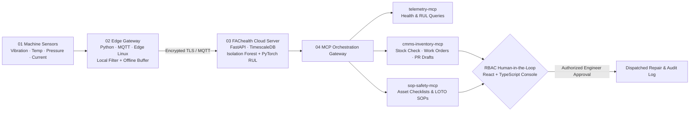

# Project FAChealth
### AI-Powered Predictive Machinery Maintenance & Repair Orchestration


> **Closed-loop detection to human-approved repair execution.** Edge gateways catch machinery anomalies locally; cloud ML forecasts Remaining Useful Life (RUL); MCP servers orchestrate spare parts, work orders, and safety SOPs under strict RBAC governance.

---

## 1. Problem Statement
* **Core Problem:** Sudden machinery breakdowns halt production lines without warning.
* **Who Is Affected:** Factory floor operators, maintenance engineers, plant managers, and spare-parts teams.
* **Why It Matters:** Fragmented sensor readings hide early degradation until expensive downtime and delayed orders hit.
* **Existing Gaps:** Basic SCADA systems rely on static alarms and manual ERP lookups; reactive maintenance causes emergency rush orders and wasted parts.

## 2. Proposed Solution
An **edge-to-cloud predictive maintenance and MCP orchestration platform** that bridges raw factory telemetry and real repair execution:
1. **Sense & Detect (Edge):** Edge Linux gateways filter vibration, thermal, pressure, and current streams locally with sub-second anomaly flags and offline buffering.
2. **Predict RUL (Cloud ML):** TimescaleDB + Isolation Forest + PyTorch models score failure risk and Remaining Useful Life (RUL).
3. **Coordinate Parts & SOPs (MCP):** Modular MCP servers check spare-part stock, draft purchase requisitions (PRs) and CMMS work orders, and attach asset-specific safety SOP checklists.
4. **Human-in-the-Loop Governance (RBAC):** Authorized engineers approve critical work orders and purchase orders via role-verified controls and immutable audit trails.

---

## 3. System Architecture



---

## 4. Competitive Edge

| Capability | **Project FAChealth** | Basic SCADA | Reactive Fixes |
| :--- | :--- | :--- | :--- |
| **Failure Prediction** | Edge anomalies + RUL window | Static threshold alarms | None (post-breakdown) |
| **Parts & Inventory** | Auto stock check + PR draft | Manual ERP lookup | Emergency rush orders |
| **Technician Guidance** | Asset checklists & safety SOPs | Raw error codes only | Paper binder search |
| **Approval Control** | Human-in-the-loop MCP + RBAC | Disconnected emails | Ad-hoc sign-offs |

---

## 5. Tech Stack
* **Edge & Sensors:** Python, MQTT, Edge Linux — sub-second local filtering and offline resilience without cloud latency.
* **AI / ML Engine:** Scikit-learn (Isolation Forest), PyTorch — real-time anomaly scoring and RUL forecasting.
* **Backend & MCP:** FastAPI, Model Context Protocol (MCP), TimescaleDB — high-throughput time-series store wired to CMMS and inventory tools.
* **UI & Security:** React, TypeScript, Device Certificates, TLS, RBAC — role-verified operator approvals and full audit logging.

---

## 6. Repository Blueprint

```text
fachealth_by_kal_dynamics/
├── README.md                          # Project overview, architecture diagram, and comparison matrix
├── docker-compose.blueprint.yml       # Local/cloud infrastructure blueprint (MQTT, TimescaleDB, API, UI)
├── requirements.txt                   # Core Python dependencies for 24-hr MVP build
├── .env.example                       # Environment variable template
├── docs/
│   ├── ARCHITECTURE.md                # Edge-to-cloud data flow, offline resilience, and OT security
│   ├── MCP_PROTOCOL_SPEC.md           # Modular MCP server contracts and human-in-the-loop gates
│   └── 24HR_MVP_ROADMAP.md            # Hour-by-hour hack-day build plan & risk mitigations
├── schemas/
│   ├── mcp_tools_manifest.json        # Formal MCP tool definitions and approval flags
│   ├── rbac_policy.json               # Role-based access control matrix for critical actions
│   └── sample_telemetry.json          # Sample CNC spindle telemetry + anomaly + RUL payload
├── edge_gateway/
│   └── config.example.yaml            # Edge sampling, threshold, MQTT TLS, and ring-buffer config
├── ml_engine/
│   └── models.py                      # Pydantic interface contracts for telemetry, RUL, and approvals
├── mcp_servers/
│   ├── README.md                      # Modular server directory (telemetry, CMMS/inventory, SOP safety)
│   ├── telemetry-mcp/
│   ├── cmms-inventory-mcp/
│   └── sop-safety-mcp/
└── dashboard_ui/
    └── README.md                      # React + TypeScript operator approval console specification
```

---

## 7. Team KALdynamics (Dayananda Sagar University)
* **Ishant Lala** (Team Lead) — `ENG26CS0774`
* **Kislay Kumar** — `ENG25AM0337`
* **Ayush Ranjan** — `ENG25AM0199`
